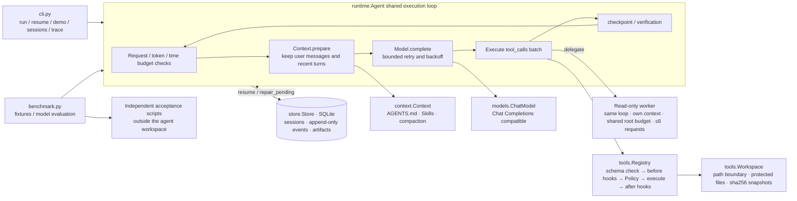

# CodeHarness

[](https://github.com/twi66li/CodeHarness/actions/workflows/ci.yml)

An extensible, inspectable coding-agent runtime written in Python. Python 3.11+, standard library only at runtime.

[中文](README.md) · This file mirrors the Chinese README; when they differ, the Chinese version is authoritative.

## Architecture



| Module | Responsibility |
| --- | --- |
| `runtime.py` | Execution loop, budgets and timeouts, retries, tool batches, read-only delegation, final status and verification |
| `models.py` | Model protocol and Chat Completions adapter: error classification, `Retry-After`, response sanitising |
| `tools.py` | Workspace path boundary, permission policy, tool registry and argument validation, built-in file/search/test/Git tools |
| `context.py` | System prompt, `AGENTS.md` and Skills loading, compaction of older turns above a threshold |
| `store.py` | SQLite append-only events, paged artifacts, usage totals, reconciliation of interrupted tool calls |
| `benchmark.py` / `benchmark_tasks.py` | Independent-acceptance evaluation, delegation ablation, business fixtures |

## Running

```powershell
python -m codeharness demo
python -m unittest discover -s tests -v
```

`demo` runs read-only delegation → locate → failing test → edit → verify in a fresh directory.
It uses a deterministic adapter and never calls a real model, so it says nothing about model fix rates.

To use any Chat Completions compatible endpoint with native tool calling, copy `.env.example` into a local `.env`.

```powershell
python -m codeharness run "Add a feature to the project and verify it" --workspace D:/your/repo --env-file .env
```

Write and test-execution permissions are asked for each time by default. Non-interactive environments must pass `--allow-write` and `--allow-exec` explicitly.
`--isolate` creates a separate worktree from HEAD of a clean Git repository and keeps the result for inspection.
`--no-delegate` disables read-only exploration workers; `--model-attempts` sets the maximum attempts per model turn (default 3, including the first request).

```powershell
python -m codeharness sessions --workspace D:/your/repo
python -m codeharness resume SESSION_ID --workspace D:/your/repo --env-file .env
python -m codeharness trace SESSION_ID --workspace D:/your/repo --json
python -m codeharness trace SESSION_ID --workspace D:/your/repo --timeline
```

`--timeline` shows model requests, tools, compaction, delegation, verification and the result in event order. It also works with `--json`. This excerpt from a `multi` order task is in UTC, with fractional seconds and call IDs omitted. The agent ran out of budget before running workspace tests. External independent acceptance passed.

```text
15:23:33  model_request  model=deepseek-v4.1-flash max_tokens=4096
15:23:34  tool_started   name=list_files
15:23:50  tool_finished  name=edit_file ok=True
15:23:54  result         status=budget_exhausted verification=not_run
```

## How it works

- The main task and read-only workers share one execution loop and one request/token budget; a worker has its own context and at most 6 requests.
- Model requests and retries share the budget. 429, common transient 5xx and retryable connection errors are retried a bounded number of times, honouring `Retry-After` or exponential backoff. Permission and authentication failures end the task and are never bypassed.
- Tools are registered centrally and declare an effect (`read` / `write` / `execute` / `delegate`). Edits check SHA-256 and reject stale content and paths outside the workspace; writing or editing a `.py` file returns a non-blocking syntax diagnostic.
- Search supports globs (including `**/`), single-file `unittest`, and non-executing `check_syntax`. At a Git repository root, read-only `git_status` and `git_diff` are available; diffs are against HEAD, cover visible tracked files only, and can be narrowed by path when long.
- SQLite records model inputs, tool results, usage and status as append-only events; long outputs are stored as artifacts and read page by page.
- On resume, interrupted tool calls are reconciled and file changes are checked; write operations with unknown outcomes are never replayed automatically.
- Above a threshold, older complete turns are compacted while every user message and the latest turns are kept. This is not a semantic summary.
- `AGENTS.md` at the project root supplies rules; the body of `.codeharness/skills/<name>/SKILL.md` is loaded on demand.
  A Skill can carry `description: short text` between `---` lines; the directory name is the call name.
- `--plugin examples/line_count.py` demonstrates a trusted Python tool extension; the registry also exposes `before` / `after` hooks.

`verified` only means the last test run in the current workspace passed and file contents are unchanged since; a later failing or incomplete test run invalidates it. It does not replace independent acceptance.
Token budgets are estimated before a request and corrected from `usage` afterwards. Only failed attempts that may have produced output (5xx, timeouts, length truncation) conservatively reserve the estimated input plus the output cap and are marked `estimated`; failures that clearly produced nothing (429, auth denial) do not consume output budget but still count towards the shared request limit. This is not a provider-side billing cap.
Each model attempt and test run uses the task's remaining time, capped at 60 seconds each; Git queries are capped at 15 seconds. Timeouts are checked at call boundaries and cannot guarantee immediate termination of every host process.
Tests run on the local machine; path checks, permissions and Git worktrees are not an OS sandbox.
Extensions are trusted local Python code with host privileges; read-only workers never load custom extensions.
There is currently no arbitrary shell, no parallel writes and no third-party plugin compatibility.

A model adapter implements `complete(messages, tools, max_tokens, *, timeout=None) -> Reply`, where `timeout` caps the remaining call time. The Chat Completions adapter keeps a string `reasoning_content` returned by the peer for later calls; provider compatibility must be confirmed by real integration. Session traces may contain private code, requirements or model output — never publish the whole database.

Test subprocesses and independent acceptance use an environment allowlist. `run` and `resume` accept `--pass-env NAME` for explicit process variables and warn for sensitive names. Workspace tools filter common private key and credential filenames.
Untracked files ignored by Git stay out of file lists, search results and `changed_files`. `search` supports `regex` and `max_results`, and uses ripgrep for regular expressions when available.
Use `apply_patch` for multi-hunk or multi-file edits. Hunk bodies use the usual space, `-` and `+` prefixes. Line numbers are optional when old text is present, and declared line counts may differ from the body. If the old text matches several locations, a line hint must identify a unique nearest match. Pure insertions and new files require an old-file start position. The tool validates all hunks before replacing files. Use `--disable-tool apply_patch` in `run`, `resume` or `benchmark` to omit it.

Five consecutive tool calls with identical arguments and results end the session with state `stalled` and CLI exit code 2. Use `trace` to view earlier warnings.

## Independent evaluation

Run the 12 basic multi-file cases (`full`) or the 3 eleven-file multi-module backend cases (`multi`) to check that each initial defect fails and the reference fix passes:

```powershell
python -m codeharness.benchmark --mode fixtures --suite full
python -m codeharness.benchmark --mode fixtures --suite multi
python -m codeharness.benchmark --mode fixtures --suite large
```

The first 5 (`core`) cover cart discounts, pagination, inventory, config merging and Decimal invoices; `full` adds date reports, CSV import, order de-duplication, backoff calculation, product search, shipping and metrics. `multi` provides 3 eleven-file backend cases (order pipeline, multi-tenant RBAC gateway, idempotent ledger reconciliation), each requiring a coordinated fix across 3 modules. These are reproducible business fixtures, not issues collected from real open-source projects.

`large` generates four reproducible repository tasks from a fixed seed. Each has two long business modules and historical implementations with matching function names. Each case runs the same independent acceptance script outside a fresh agent workspace. The initial version must fail a requirement assertion before the reference fix or real agent is verified. Reports include `success`, request count, tokens, duration and budget skips at `.codeharness/benchmarks/<id>/report.json`. Databases and case workspaces stay in the report directory for traceability.

### Real models and ablation

Only in an environment with a configured `.env`, explicit consent to run test code locally, and an agreed call budget.

Start with a fixed model and only `discount` to confirm native tool calling, independent acceptance and budget behaviour, then expand to the 5 core tasks. The current preferred model is `glm-5.3`:

```powershell
python -m codeharness.benchmark --mode model --task discount --model glm-5.3 --env-file .env --allow-exec --total-requests 12 --total-tokens 24000
```

`.env` holds an authorised model configuration: `CODEHARNESS_BASE_URL`, `CODEHARNESS_API_KEY` and optional `CODEHARNESS_MODEL`. If no URL is given on the command line or via CodeHarness/OpenAI variables, `DASHSCOPE_BASE_URL` and `DASHSCOPE_API_KEY` are read as a pair, with `--model` selecting the model. Credentials stay in local configuration. `--task` and `--suite` are mutually exclusive. The report's `diagnostics` include model errors, retries, tool errors and failed verifications, with tool errors grouped by tool name.

```powershell
python -m codeharness.benchmark --mode model --suite core --env-file .env --allow-exec --total-requests 60 --total-tokens 120000
```

To compare delegation on and off, each task uses its own workspace, the same model and the same per-case limits (default 12 requests, 24,000 tokens, 180 seconds):

```powershell
python -m codeharness.benchmark --mode model --suite core --variants both --env-file .env --allow-exec --total-requests 120 --total-tokens 240000
```

A pair is recorded as `skipped` when the total budget cannot start it. Actual provider billing may exceed the runtime's estimated budget. Explicit authentication or access denial stops the remaining cases. Compare success rate, tokens and duration only over complete pairs, and account for model non-determinism. `--output-tokens` sets the per-call output cap (default 2048). `--output` names a report directory that must not exist yet; `--suite full` expands to the 12 basic tasks and `--suite multi` runs the 3 multi-module tasks. `diagnostics` also count `delegate_calls` and `compactions`.

Where the endpoint supports it, `--reasoning-effort low` lowers reasoning effort in `run`, `resume` or `benchmark`; reports record an explicitly set value. See the [Model Studio GLM docs](https://help.aliyun.com/zh/model-studio/glm) for `glm-5.3` values.

`--repeats N` runs each task and variant N times. Set a total budget covering all rounds. `--context-chars` sets the character threshold for context compaction. `cache_hit_ratio` divides provider-reported cached tokens by input tokens and is `null` when input usage is zero.

```powershell
python -m codeharness.benchmark compare --baseline baseline/report.json --treatment treatment/report.json
```

The comparison pairs runs by model, task and round. For each model it reports the success rate difference, a bootstrap 95% confidence interval, and median request and token differences. Use `--baseline-variant` or `--treatment-variant` to select a delegation variant when a report contains both.

Benchmark acceptance still executes model-written Python code locally; the independent acceptance directory is not a tamper-proof sandbox. Use only for trusted evaluation tasks.

### Model quota pool

Copy `models.example.json` to `.codeharness/models.json`, then set the quota snapshot time, token balances and expiry dates from your provider. Run `python -m codeharness.model_pool status` to view the balances. Worktrees can share a ledger by passing the same absolute configuration path.

```powershell
python -m codeharness.benchmark --mode model --task discount --model-pool .codeharness/models.json --models deepseek-v4.1-flash,deepseek-v4.1-flash-1017 --env-file .env --allow-exec --total-requests 12 --total-tokens 24000
```

Benchmark pairs run on one model. Quota exhaustion preserves the tokens already used and restarts the pair on another eligible model. `run` and `resume` also accept `--model-pool` and `--models`, and charge each actual request against the session budget. `sessions` shows the starting model, and `model_request` events in `trace` identify the model used for each request.

### Current results and limits

| Item | Result | Notes |
| --- | --- | --- |
| Unit and contract tests | 127/129 passed (2 skipped) | Symlink permissions and the opt-in scale test account for the local skips |
| Reference fixture acceptance | 19/19 passed | `full` 12, `multi` 3, `large` 4. Every initial version fails its assertions and every reference fix passes (0 model calls) |
| `glm-5.3` (`core`, `low`, 4096) | 4/5 (original prompt); `invoice` 1/1 after clarification | 33 requests, 65,570 tokens, 65.82 s, 0 model errors; acceptance exposed a negative-rounding difference under the original prompt |
| `glm-5.3` (`multi`, `low`, 4096) | 3/3 passed | All three 11-file backend tasks fixed across exactly 3 modules; 22 requests, 62,579 tokens, 53.41 s, 0 model errors; `write_file` misuse errors dropped from 3 to 0 |

**S13 real-model comparisons.** Each row uses same-model pairs. The 95% confidence intervals bootstrap over tasks and use percentage points.

| Experiment and model | Same-model pairs | Independent acceptance | Success rate change with 95% CI |
| --- | ---: | --- | --- |
| S0b → current version, `core`, `deepseek-v4.1-flash` | 10 (5 tasks × 2 rounds) | 10/10 → 10/10 | 0 [0, 0] |
| S0b → current version, `multi`, `deepseek-v4.1-flash` | 6 (3 tasks × 2 rounds) | 6/6 → 3/6 | −50 [−100, 0] |
| `apply_patch` enabled → disabled, `deepseek-v4.1-flash` | 4 (3 tasks, 1–2 rounds) | 2/4 → 4/4 | +50 [0, 100] |
| Delegation unavailable → available, `deepseek-v4.1-flash-1017` | 6 (3 tasks × 2 rounds) | 1/6 → 0/6 | −16.7 [−50, 0] |
| Compaction threshold 28,000 → 8,000 characters, `deepseek-v4.1-flash-1017` | 4 (2 tasks × 2 rounds) | 1/4 → 0/4 | −25 [−50, 0] |

The model made zero delegation calls across the six runs where the tool was available. In the threshold experiment, compactions increased from 14 to 40 and the median paired request difference was +4. These small samples inform follow-up investigation. The deterministic demo validates the execution path in 8 requests with delegation and 5 without. Use the evaluation commands above to reproduce the runs. Reports are saved locally under `.codeharness/benchmarks/`.

**Magpie follow-up (2026-11-24).** We ran the three `multi` tasks twice on `workbuddy/deepseek-v4.1-flash`. With the revised patch syntax, patch outcomes changed from 0 successes and 6 failures to 4 successes and 1 failure. Both versions passed 6/6 independent checks. On the new version, enabling and disabling patches both passed 6/6, with 59 and 55 requests respectively. These pairs use the same Magpie route.

The original large-repository prompts still produced no spontaneous delegation. When explicitly asked to delegate a single-file investigation, the model invoked `delegate`. The child completed one read-only search in two model requests and returned call-site evidence. The parent passed independent acceptance. This run verifies the live delegation path. Its performance benefit remains unmeasured.

**S15 patch and delegation experiments.** Offline replays of real rejected patches improved from 6/27 to 23/27. With the same Magpie model, `core` passed 5/5 and the six matched `multi` runs passed in both patch configurations, each with a median of 10 requests. The new `investigate-order-ledger` fixture requires fixes in two independent call chains and its reference solution passed. Under a 120,000-token case budget, both delegation pilot runs exhausted their budgets and made zero delegation calls. The full comparison stopped at the pilot gate.

Use `python -m unittest discover -s tests -v` for a full regression. If local loopback connections are forbidden, set `$env:CODEHARNESS_SKIP_LOOPBACK='1'` in PowerShell to explicitly skip the 5 real local HTTP integration tests; simulated transport and CLI tool-chain tests still run. That mode is not a full network regression.

`python -B scripts/regress.py --tag <tag>` runs unit tests, the `full`, `multi` and `large` reference fixtures, and the offline demo with and without delegation. Logs and results go to `.codeharness/regress/`. Use `--compare <summary.json>` to compare with an earlier run and `--skip-loopback` as an alternative to setting the environment variable above. CI runs the same script on Ubuntu and Windows with Python 3.11–3.13.

## Design trade-offs

- The loop is not bound to any provider SDK; model interface, tool permissions, context, event persistence and CLI are explicitly separated.
- SQLite events keep reproducible inputs and execution evidence; file checkpoints detect change and are not automatic transactional rollback.
- Read-only exploration first, then edit and test when needed; task outcomes are judged by independent acceptance. Syntax diagnostics are not functional verification and do not block intermediate edits.
- Lightweight and observable over high concurrency, multi-model orchestration or a GUI; real model data should drive the next optimisation.

Design references: [Pi](https://github.com/earendil-works/pi),
[Claude Code public docs](https://code.claude.com/docs/en/how-claude-code-works),
[DeepSeek Harness](https://github.com/deepseek-ai/deepseek-harness),
[oh-my-pi](https://github.com/can1357/oh-my-pi). This project is an independent Python implementation and copies none of their runtime code.
