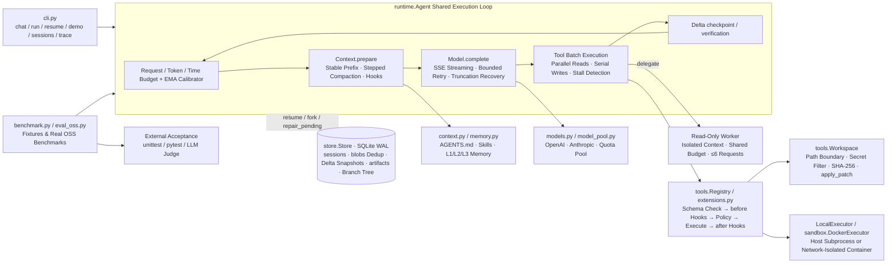

# CodeHarness

[](https://github.com/twi66li/CodeHarness/actions/workflows/ci.yml)

An extensible, inspectable coding-agent runtime and independent evaluation harness written in pure Python. Requires Python 3.11+ with zero third-party runtime dependencies.

[中文](README.md)

## Key Features

- **Unified Execution Loop & Budget Control**: Main sessions and read-only delegation workers share one loop and a three-dimensional budget (requests, tokens, wall-clock time), backed by an EMA token calibrator, classified 429/5xx backoff retries, bounded truncation recovery, repeated-tool `stalled` detection, and a multi-model `ModelPool` quota ledger with automatic failover.
- **Dual Model Protocols & Interactive / Headless Modes**: Native adapters for OpenAI Chat Completions compatible endpoints and Anthropic Messages with SSE streaming (`reasoning_content` and `reasoning_effort` supported). Ships both an interactive `chat` REPL (`/compact`, `/tree`, `/fork`, `/switch`, `/model`, `!command`) and headless `run` / `resume` modes, plus a minimal 4-tool `pi` profile.
- **Policy Gate & Optional Docker Sandbox**: Case-insensitive workspace path and credential filtering, a `Policy` authorization gate that hooks cannot bypass, subprocess environment allowlisting, Git worktree isolation (`--isolate`), and an optional `--sandbox docker` ephemeral container backend (`--network none`, read-only rootfs, memory/CPU/PID caps).
- **Reliable Editing & Multi-Format Patching**: SHA-256 optimistic locking on edits, Windows CRLF and UTF-8 BOM preservation, non-blocking Python AST syntax diagnostics on write/edit, parallel execution of read-only tool batches, and atomic multi-file `apply_patch` supporting unified diff and OpenAI patch formats with full pre-validation and rollback.
- **Event Sourcing, Crash Recovery & Traceability**: Append-only SQLite (WAL) event store with content-addressed `blobs` deduplication and delta file checkpoints; `repair_pending` reconciles interrupted calls without replaying uncertain writes; every model call and tool invocation links `session_id`, `turn`, `call_id`, token usage, `cached_tokens`, and `duration_ms` for `trace --timeline` inspection.
- **Context Engineering, Three-Tier Memory & Extensions**: Stable `system` prefix and 4-turn stepped compaction to preserve Prompt Cache hits, paged `artifact` offloading for large outputs, `AGENTS.md` project rules, on-demand `SKILL.md` loading, L1 pinned / L2 SQLite FTS5+TTL / L3 Markdown memory, and an `ExtensionAPI` lifecycle hook system.
- **Independent Evaluation Suites**: Built-in 19-case business benchmark (`core` / `full` / `multi` / `large`, external acceptance scripts, same-model paired comparison with bootstrap 95% CIs) and a real open-source repository suite (`pluggy` / `packaging` / `click`, 12 Fix tasks with hidden F2P/P2P tests + 8 Review tasks scored with LLM-as-a-Judge).

## Architecture



| Module | Responsibility |
| --- | --- |
| `runtime.py` | Shared loop, request/token/time budgets, retries, truncation recovery, stall detection, parallel read batches, per-turn & latency telemetry |
| `models.py` / `model_pool.py` | OpenAI Chat Completions and Anthropic Messages adapters, SSE streaming, sanitized error classification, quota ledger & failover |
| `tools.py` / `sandbox.py` | Workspace path & credential guards, `Policy` gate, file/regex/Git/test/`bash`/`apply_patch` tools, local and Docker executors |
| `context.py` / `tokens.py` | System prompt, `AGENTS.md` and `SKILL.md` loading, cache-friendly stepped compaction, token estimation & EMA calibration |
| `store.py` | SQLite (WAL) append-only events, `blobs` deduplication, delta checkpoints, paged artifacts, `repair_pending`, branch tree (`fork`/`turns`) |
| `extensions.py` / `memory.py` | `ExtensionAPI` plugin host & lifecycle hooks, L1 runtime pins / L2 SQLite FTS5+TTL / L3 Markdown memory |
| `cli.py` | `chat` / `run` / `resume` / `demo` / `sessions` / `trace` CLI entrypoints and Git worktree isolation |
| `benchmark.py` / `benchmark_tasks.py` / `benchmark_large.py` | 19 built-in business fixtures, external acceptance runner, ablation & paired bootstrap statistics |
| `eval_oss.py` / `eval_oss_tasks.json` | Real open-source Issue/PR evaluation suite (12 Fix F2P/P2P + 8 Review LLM-as-a-Judge) |

## Quick Start

### 1. Offline Demo & Tests

```powershell
# Offline demo: read-only delegation → locate → failing test → edit → verify (no live AI calls)
python -m codeharness demo

# Run unit tests
python -m unittest discover -s tests -v

# Run full offline regression (unit tests + 19 reference fixtures + offline demos)
python -B scripts/regress.py --tag local
```

> In environments that block local loopback sockets, set `$env:CODEHARNESS_SKIP_LOOPBACK='1'` or pass `--skip-loopback` to skip the 5 local HTTP integration tests.

### 2. Model Configuration

Copy `.env.example` into a local `.env` (git-ignored; never commit real credentials):

- **OpenAI Chat Completions compatible**: set `CODEHARNESS_BASE_URL`, `CODEHARNESS_API_KEY`, and `CODEHARNESS_MODEL` (also accepts `OPENAI_*` or paired `DASHSCOPE_BASE_URL` / `DASHSCOPE_API_KEY`).
- **Anthropic Messages**: set `ANTHROPIC_API_KEY`, `ANTHROPIC_MODEL` (optional `ANTHROPIC_BASE_URL`), and pass `--provider anthropic`.

### 3. Headless Execution (`run` / `resume`)

```powershell
# Basic run (prompts per write/execute by default; pass explicit flags in non-interactive shells)
python -m codeharness run "Fix percentage discount calculation and verify tests" --workspace D:/your/repo --env-file .env --allow-write --allow-exec

# Modify in an isolated Git worktree while keeping the original working tree untouched
python -m codeharness run "Refactor order validation" --workspace D:/your/repo --env-file .env --isolate --allow-write --allow-exec

# Execute tests and bash inside an ephemeral, network-isolated Docker sandbox
python -m codeharness run "Diagnose and fix failing tests" --workspace D:/your/repo --env-file .env --enable-bash --sandbox docker --sandbox-image python:3.12-slim --allow-write --allow-exec

# Resume an interrupted or budget-exhausted session (reconciles pending tool calls without replaying uncertain writes)
python -m codeharness resume SESSION_ID --workspace D:/your/repo --env-file .env --allow-write --allow-exec
```

Common flags:
- `--tool-profile default|pi`: `default` exposes the full controlled toolset; `pi` exposes only `read_file`, `write_file`, `edit_file`, and `bash`.
- `--no-delegate` / `--disable-tool NAME`: disable read-only workers or omit individual tools (e.g. `--disable-tool apply_patch`).
- `--reasoning-effort low` / `--output-tokens 4096` / `--max-requests` / `--max-tokens` / `--max-seconds`: tune reasoning depth and budgets.
- `--pass-env NAME`: explicitly forward an environment variable into test/shell subprocesses (allowlist by default; warns on secret-like names).

### 4. Interactive Mode (`chat`)

```powershell
python -m codeharness chat --workspace D:/your/repo --env-file .env --confirm
```

`chat` enables SSE streaming, `bash`, and local three-tier memory by default (`--no-stream`, `--no-bash`, `--no-memory` disable them; `--confirm` prompts before writes/execution; `--sandbox docker` isolates command execution inside a container).

| Command | Description |
| --- | --- |
| `/help` · `/tools` · `/session` | Show help, active tools, current session ID, and cumulative token usage |
| `/compact [focus]` | Manually compact older turns while preserving user constraints and recent turns |
| `/tree` · `/fork [turn] [label]` · `/switch <ID>` | Inspect branch lineage and turns, fork from a turn, or switch branches (shared filesystem) |
| `/model [name]` | Show or hot-switch model; supports `openai:<name>` and `anthropic:<name>` cross-protocol switches |
| `/pin` · `/memory` · `/remember` | Manage L1 session pins, L2 cross-session short-term memory, and L3 categorized Markdown memory |
| `!<command>` | Run a local shell command directly in the workspace |

### 5. Sessions & Timeline Auditing (`sessions` / `trace`)

```powershell
python -m codeharness sessions --workspace D:/your/repo
python -m codeharness trace SESSION_ID --workspace D:/your/repo --timeline
python -m codeharness trace SESSION_ID --workspace D:/your/repo --timeline --json
```

`--timeline` prints a compact chronological trace linking `turn`, `attempt`, `call_id`, token usage, and per-call `duration_ms`:

```text
2026-11-27T04:15:10+00:00  model_request  turn=1 attempt=1 model=deepseek-v4.1-flash max_tokens=4096
2026-11-27T04:15:11+00:00  usage          turn=1 input_tokens=1820 output_tokens=94 cached_tokens=1024 duration_ms=1120
2026-11-27T04:15:11+00:00  tool_started   turn=1 name=list_files call_id=call_1
2026-11-27T04:15:11+00:00  tool_finished  turn=1 name=list_files call_id=call_1 duration_ms=12 ok=True
2026-11-27T04:15:24+00:00  result         status=verified verification=passed
```

## Extensions, Skills & Model Pool

- **Project Rules & On-Demand Skills**: `AGENTS.md` at the repository root supplies project rules. `.codeharness/skills/<name>/SKILL.md` files with a YAML frontmatter `description` are indexed lightly and loaded on demand via `load_skill` as a message (when no skills exist, `load_skill` is not registered).
- **Python Extensions & Hooks**: Pass `--plugin <file.py>`, or `--discover-extensions` in `chat` to load `.codeharness/extensions/*.py`. Extensions define `setup(api)` to register tools, slash commands, and lifecycle hooks (`before_tool`, `after_tool`, `before_context`, `before_compact`, etc.), while remaining compatible with `register(registry)`. See [examples/line_count.py](examples/line_count.py) and [examples/bash_guard.py](examples/bash_guard.py).
- **Model Quota Pool (`ModelPool`)**: Copy `models.example.json` to `.codeharness/models.json`, inspect balances via `python -m codeharness.model_pool status`, and pass `--model-pool .codeharness/models.json --models m1,m2` to `run`, `resume`, or `benchmark` for append-only quota accounting and automatic model failover.

## Evaluation & Benchmarks

CodeHarness separates workspace self-verification (`verified`) from external independent acceptance and provides two reproducible benchmark suites:

### 1. Built-In Business Benchmark (`codeharness.benchmark`)

19 reproducible standard-library Python repositories with acceptance scripts stored outside the agent workspace:
- `core` (5 cases) and `full` (12 cases): pricing discounts, pagination, inventory, config merging, Decimal invoicing, date reporting, CSV import, order deduplication, backoff, search, shipping, and metrics.
- `multi` (3 cases): order pipeline, multi-tenant RBAC gateway, and idempotent ledger reconciliation (11 files each, requiring coordinated fixes across 3 modules).
- `large` (4 cases): fixed-seed larger repositories with long business modules and historical duplicate implementations.

```powershell
# Offline validation of all 19 reference fixtures (0 model calls)
python -m codeharness.benchmark --mode fixtures --suite full
python -m codeharness.benchmark --mode fixtures --suite multi
python -m codeharness.benchmark --mode fixtures --suite large

# Live model evaluation (report saved to .codeharness/benchmarks/<id>/report.json)
python -m codeharness.benchmark --mode model --suite core --model <model> --env-file .env --allow-exec --output-tokens 4096 --total-requests 60 --total-tokens 120000

# Paired statistical comparison (same model/task/round success delta, bootstrap 95% CI, median request/token deltas)
python -m codeharness.benchmark compare --baseline baseline/report.json --treatment treatment/report.json
```

### 2. Real Open-Source Repository Suite (`codeharness.eval_oss`)

12 real bug-fix tasks (evaluated against hidden `test_patch` for FAIL_TO_PASS and PASS_TO_PASS) and 8 real defect-introducing PR review tasks (evaluated with LLM-as-a-Judge against subsequent bug-fix ground truth) sourced from `pytest-dev/pluggy`, `pypa/packaging`, and `pallets/click`:

```powershell
# Offline golden-baseline gate check for all 12 Fix + 8 Review cases (0 tokens)
python -m codeharness.eval_oss validate

# Run live model Fix / Review evaluations
python -m codeharness.eval_oss run-fix --env-file .env --enable-bash
python -m codeharness.eval_oss run-review --env-file .env
```

### Benchmark Results

| Evaluation | Scope / Model | Results |
| --- | --- | --- |
| Unit & Contract Regression | Full offline suite (incl. 4-stage process crash recovery) | **163/165 passed** (2 skipped: symlink permission & opt-in scale test); CI green across Ubuntu / Windows × Python 3.11–3.13 (6 jobs) |
| Built-In Reference Fixtures | `full` 12 + `multi` 3 + `large` 4 | **19/19 passed** (every baseline fails assertions, every reference fix passes, 0 model calls) |
| Multi-Format Patch Replay Corpus | 27 real patch samples | **27/27 applied cleanly**, all 80 written Python files pass `ast.parse` syntax validation |
| Built-In Business Benchmark | `glm-5.3` (`low`, 4096) / `deepseek-v4.1-flash` | `glm-5.3`: `core` 4/5, `multi` **3/3** (22 requests, 62,579 tokens, 0 model errors); `deepseek-v4.1-flash`: `core` **5/5**, `multi` **6/6** (2 repeats) |
| Real OSS Fix Suite | `pluggy` / `packaging` / `click` (12 tasks, `deepseek-v4.1-flash`) | Resolved **10/12 (83.3%)**; FAIL_TO_PASS **67/73 (91.8%)**; PASS_TO_PASS **6,797/6,797 (100.0%, zero regressions)** |
| Real OSS Review Suite | `pluggy` / `packaging` / `click` (8 tasks, `deepseek-v4.1-flash`) | 20 findings, TP 6 / FP 14; Precision **30.0%**, Recall **25.0%**, F1 **27.3%** (long-diff false positives and reasoning-tail truncation remain primary bottlenecks) |

## Security Model & Boundaries

- **Application Gate vs. Container Sandbox**: File and Git tools enforce workspace path boundaries, case-insensitive protected file filtering (`.env*`, `.git`, `.ssh`, private keys, etc.), and a `Policy` gate that hooks cannot bypass; test and shell subprocesses use an environment allowlist. Under `--sandbox local`, commands still execute on the host (path checks and Git worktrees are not an OS sandbox). For untrusted code or strict OS isolation, pass `--sandbox docker` (`--network none`, read-only rootfs, memory/CPU/PID limits, and `docker rm -f` cleanup on timeout).
- **Verification & Budget Semantics**: `verified` only means the last workspace test run passed and files remain unchanged; it does not replace independent acceptance. Token budgets are estimated pre-request with EMA calibration and corrected from provider `usage` afterwards; they are not provider billing hard caps. Failed attempts reserve output budget only when output may have been generated (5xx, timeout, length truncation), while 429/auth denials count toward shared request limits without burning output budget.
- **Extensions & Trace Privacy**: Python extensions run with trusted host privileges and are never loaded into read-only delegation workers. SQLite traces store full model inputs and tool outputs—never publish databases containing private code or credentials.

---

Design references: [Pi](https://github.com/earendil-works/pi), [Claude Code docs](https://code.claude.com/docs/en/how-claude-code-works), [DeepSeek Harness](https://github.com/deepseek-ai/deepseek-harness), and [oh-my-pi](https://github.com/can1357/oh-my-pi). Independent Python implementation; no runtime code copied.
