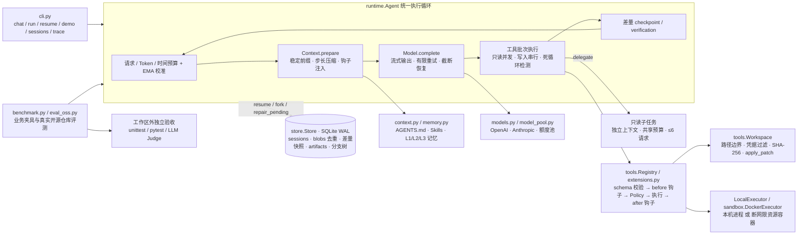

# CodeHarness

[](https://github.com/twi66li/CodeHarness/actions/workflows/ci.yml)

使用纯 Python 标准库实现的可扩展编码 Agent 运行时与独立评测底座。要求 Python 3.11+，运行时零第三方依赖。

[English](README.en.md)

## 核心特性

- **统一执行循环与预算治理**：主任务与只读探索子任务共享执行循环和请求 / Token / 时间三维预算；内置 EMA 动态 Token 校准器、429/5xx 分类错误与退避重试、输出截断恢复、连续重复操作 `stalled` 熔断，以及 `ModelPool` 多模型额度台账与耗尽自动切换。
- **双协议与流式交互**：原生适配 OpenAI Chat Completions 兼容接口与 Anthropic Messages 协议，支持 SSE 流式输出（含 `reasoning_content` 与 `reasoning_effort`）；同时提供本地交互式 `chat` 模式（支持 `/compact`、`/tree`、`/fork`、`/switch`、`/model`、`!命令`）与无头批处理 `run` / `resume` 模式，并支持精简 4 工具 `pi` 模式。
- **工具门控与可选 Docker 沙箱**：工作区路径边界校验与敏感凭据文件过滤、Hooks 不可绕过的 `Policy` 权限门控、测试子进程环境变量白名单、Git Worktree 隔离（`--isolate`），以及可选 `--sandbox docker` 断网限资源临时容器执行环境。
- **稳健的代码编辑与多格式补丁**：编辑校验 SHA-256 乐观锁并兼容 Windows CRLF / UTF-8 BOM；写入或编辑 `.py` 文件附带非阻塞 AST 语法诊断；同批只读工具并发执行、写操作串行；`apply_patch` 兼容统一 diff 与 OpenAI 补丁格式，全校验后写入并在失败时回滚。
- **事件溯源、崩溃恢复与全链路观测**：SQLite（WAL）追加事件日志配合内容寻址去重与差量文件检查点；中断恢复（`repair_pending`）绝不自动重放结果未知的写操作；全链路按 `session_id`、`turn`、`call_id` 关联 Token 用量、缓存命中（`cached_tokens`）与精确单次耗时（`duration_ms`），支持 `trace --timeline` 审计回放。
- **上下文工程、三层记忆与扩展系统**：保持 `system` 前缀稳定、按 4 回合步长推进历史压缩保护 Prompt Cache，超长工具输出自动归档至 `artifact` 分页读取；支持 `AGENTS.md` 规则、`SKILL.md` 按需加载、L1 置顶 / L2 SQLite FTS5+TTL / L3 Markdown 三层记忆，以及 `ExtensionAPI` 插件与生命周期钩子。
- **独立评测体系**：内置工作区外独立验收业务基准（`core` / `full` / `multi` / `large`，支持同模型配对与 bootstrap 95% 置信区间统计）及真实开源仓库（`pluggy` / `packaging` / `click`）12 Fix + 8 Review 评测套件。

## 系统架构



| 模块 | 职责 |
| --- | --- |
| `runtime.py` | 统一执行循环、三维预算与重试、截断恢复、死循环检测（`stalled`）、只读工具并发、轮次与耗时埋点 |
| `models.py` / `model_pool.py` | OpenAI Chat Completions 与 Anthropic Messages 协议适配、SSE 流式、错误分类脱敏、模型额度台账与自动切换 |
| `tools.py` / `sandbox.py` | 路径边界与凭据保护、`Policy` 权限门控、文件/正则搜索/Git/测试/`bash`/`apply_patch` 工具、本机与 Docker 沙箱执行器 |
| `context.py` / `tokens.py` | 系统提示、`AGENTS.md` 与 `SKILL.md` 按需加载、稳定前缀历史压缩、Token 估算与 EMA 校准 |
| `store.py` | SQLite（WAL）追加事件、`blobs` 内容寻址去重、差量检查点、产物分页、`repair_pending` 恢复与会话分支树 |
| `extensions.py` / `memory.py` | `ExtensionAPI` 生命周期钩子与插件加载、L1 置顶 / L2 SQLite FTS5+TTL / L3 Markdown 三层会话记忆 |
| `cli.py` | `chat` / `run` / `resume` / `demo` / `sessions` / `trace` 命令行入口、Git Worktree 隔离 |
| `benchmark.py` / `benchmark_tasks.py` / `benchmark_large.py` | 内置 19 题独立验收业务基准、委派消融与同模型配对统计比较 |
| `eval_oss.py` / `eval_oss_tasks.json` | 真实开源仓库 Issue/PR 评测套件（12 Fix F2P/P2P 验收 + 8 Review LLM-as-a-Judge） |

## 快速开始

### 1. 离线体验与测试

```powershell
# 离线演示：在新建目录演示 只读委派 → 定位 → 失败测试 → 修改 → 验证（不调用真实 AI）
python -m codeharness demo

# 运行单元测试
python -m unittest discover -s tests -v

# 运行完整离线回归（单元测试 + 19 个参考夹具 + 离线 demo）
python -B scripts/regress.py --tag local
```

> 若在禁止本地回环连接的环境中运行测试，可设置 `$env:CODEHARNESS_SKIP_LOOPBACK='1'` 或传入 `--skip-loopback` 跳过 5 项本地 HTTP 集成测试。

### 2. 配置模型接口

将 `.env.example` 复制为本地 `.env`（已被 `.gitignore` 忽略，勿提交凭据）：

- **OpenAI Chat Completions 兼容接口**：配置 `CODEHARNESS_BASE_URL`、`CODEHARNESS_API_KEY`、`CODEHARNESS_MODEL`（亦兼容 `OPENAI_*` 或成对的 `DASHSCOPE_BASE_URL` / `DASHSCOPE_API_KEY`）。
- **Anthropic Messages 原生接口**：配置 `ANTHROPIC_API_KEY`、`ANTHROPIC_MODEL`（可选 `ANTHROPIC_BASE_URL`），并在命令中传入 `--provider anthropic`。

### 3. 无头任务模式（`run` / `resume`）

```powershell
# 基础运行（默认对写入与执行逐次询问；非交互环境需显式授权）
python -m codeharness run "修复折扣计算并运行测试验证" --workspace D:/your/repo --env-file .env --allow-write --allow-exec

# 在独立 Git worktree 中修改，保持原工作区干净
python -m codeharness run "重构订单校验逻辑" --workspace D:/your/repo --env-file .env --isolate --allow-write --allow-exec

# 使用断网限资源 Docker 容器执行测试与 bash
python -m codeharness run "排查并修复失败用例" --workspace D:/your/repo --env-file .env --enable-bash --sandbox docker --sandbox-image python:3.12-slim --allow-write --allow-exec

# 恢复中断或预算耗尽的会话（先对账未完成工具调用并检查磁盘变化，不重放未知写操作）
python -m codeharness resume SESSION_ID --workspace D:/your/repo --env-file .env --allow-write --allow-exec
```

常用运行参数：
- `--tool-profile default|pi`：`default` 为完整受控工具集；`pi` 为精简 4 工具模式（`read_file`、`write_file`、`edit_file`、`bash`）。
- `--no-delegate` / `--disable-tool NAME`：关闭只读委派或禁用指定工具（如 `--disable-tool apply_patch`）。
- `--reasoning-effort low` / `--output-tokens 4096` / `--max-requests` / `--max-tokens` / `--max-seconds`：控制推理强度与三维预算。
- `--pass-env NAME`：显式向测试/命令子进程传递指定环境变量（默认走环境变量白名单，敏感变量名会触发警告）。

### 4. 本地交互开发模式（`chat`）

```powershell
python -m codeharness chat --workspace D:/your/repo --env-file .env --confirm
```

`chat` 默认开启 SSE 流式输出、`bash` 工具与本地三层记忆（可用 `--no-stream`、`--no-bash`、`--no-memory` 关闭；`--confirm` 开启写文件与命令执行前确认；`--sandbox docker` 可将命令与测试放入容器隔离运行）。

| 交互命令 | 说明 |
| --- | --- |
| `/help` · `/tools` · `/session` | 查看帮助、已启用工具列表、当前会话 ID 与实时 Token 用量 |
| `/compact [重点]` | 手动压缩较早对话并保留用户约束与最近完整回合 |
| `/tree` · `/fork [回合] [备注]` · `/switch <ID>` | 查看分支树与回合列表、从指定回合分叉新分支、切换分支（共享工作目录） |
| `/model [名称]` | 查看当前模型或热切换模型；支持 `openai:<name>` / `anthropic:<name>` 跨协议切换 |
| `/pin` · `/memory` · `/remember` | 管理 L1 会话置顶约束、L2 跨会话短期记忆与 L3 分类 Markdown 长期记忆 |
| `!<命令>` | 在当前工作区直接执行本地 Shell 命令 |

### 5. 会话查询与全链路审计（`sessions` / `trace`）

```powershell
python -m codeharness sessions --workspace D:/your/repo
python -m codeharness trace SESSION_ID --workspace D:/your/repo --timeline
python -m codeharness trace SESSION_ID --workspace D:/your/repo --timeline --json
```

`--timeline` 按顺序输出关联 `turn`、`attempt`、`call_id`、Token 用量与单次 `duration_ms` 的精简时间线，便于排障与成本审计：

```text
2026-11-27T04:15:10+00:00  model_request  turn=1 attempt=1 model=deepseek-v4.1-flash max_tokens=4096
2026-11-27T04:15:11+00:00  usage          turn=1 input_tokens=1820 output_tokens=94 cached_tokens=1024 duration_ms=1120
2026-11-27T04:15:11+00:00  tool_started   turn=1 name=list_files call_id=call_1
2026-11-27T04:15:11+00:00  tool_finished  turn=1 name=list_files call_id=call_1 duration_ms=12 ok=True
2026-11-27T04:15:24+00:00  result         status=verified verification=passed
```

## 扩展、Skills 与模型额度池

- **项目规则与按需 Skills**：仓库根目录 `AGENTS.md` 自动注入为项目规则；`.codeharness/skills/<name>/SKILL.md` 支持 YAML frontmatter 中的 `description`，初始仅暴露索引，模型按需调用 `load_skill` 后以独立消息注入正文（工作区无 Skill 时不注册工具，零额外 Token 占用）。
- **Python 扩展与钩子**：可通过 `--plugin <file.py>` 加载扩展，或在 `chat` 中传 `--discover-extensions` 加载 `.codeharness/extensions/*.py`。支持 `setup(api)` 注册工具、斜杠命令与 6 个生命周期钩子（`before_tool`、`after_tool`、`before_context`、`before_compact` 等），同时兼容旧版 `register(registry)`。内置示例见 [examples/line_count.py](examples/line_count.py) 与 [examples/bash_guard.py](examples/bash_guard.py)。
- **模型额度池（`ModelPool`）**：复制 `models.example.json` 至 `.codeharness/models.json`，执行 `python -m codeharness.model_pool status` 查看剩余额度；在 `run`、`resume` 或 `benchmark` 中传入 `--model-pool .codeharness/models.json --models m1,m2` 即可按台账记账并在额度耗尽时自动切换可用模型。

## 独立评测体系与基准结果

CodeHarness 将 Agent 工作区内的自测状态（`verified`）与工作区外独立验收严格分离，提供两套可复现评测工具：

### 1. 内置业务基准（`codeharness.benchmark`）

包含 19 个可复现的标准库 Python 业务夹具，验收脚本位于工作区之外：
- `core`（5 题）与 `full`（12 题）：覆盖折扣、分页、库存、配置合并、Decimal 发票、日期报表、CSV 导入、去重、退避、搜索、运费、指标统计；
- `multi`（3 题）：订单结算管线、多租户 RBAC 网关、财务幂等对账，每题 11 个文件、需跨 3 个模块联动修复；
- `large`（4 题）：固定种子生成的大仓库任务，包含长业务模块与同名历史实现。

```powershell
# 离线验证全部 19 个参考夹具（0 模型调用）
python -m codeharness.benchmark --mode fixtures --suite full
python -m codeharness.benchmark --mode fixtures --suite multi
python -m codeharness.benchmark --mode fixtures --suite large

# 使用真实模型评测并输出报告（保存至 .codeharness/benchmarks/<id>/report.json）
python -m codeharness.benchmark --mode model --suite core --model <model> --env-file .env --allow-exec --output-tokens 4096 --total-requests 60 --total-tokens 120000

# 配对统计比较（按同模型/任务/轮次给出成功率差、bootstrap 95% 置信区间及请求/Token 差中位数）
python -m codeharness.benchmark compare --baseline baseline/report.json --treatment treatment/report.json
```

### 2. 真实开源仓库评测（`codeharness.eval_oss`）

基于 `pytest-dev/pluggy`、`pypa/packaging`、`pallets/click` 构建 12 道真实 Bug Fix（分离隐藏 `test_patch` 校验 FAIL_TO_PASS 与 PASS_TO_PASS）与 8 道真实缺陷 PR Review（以事后真实修复为 Ground Truth，使用 LLM-as-a-Judge 评测 Precision / Recall / F1）：

```powershell
# 离线黄金基线门禁校验（校验全部 12 Fix + 8 Review 夹具合法性，0 Token）
python -m codeharness.eval_oss validate

# 运行真实模型 Fix / Review 评测
python -m codeharness.eval_oss run-fix --env-file .env --enable-bash
python -m codeharness.eval_oss run-review --env-file .env
```

### 基准测试结果汇总

| 评测维度 | 范围 / 模型 | 实测结果 |
| --- | --- | --- |
| 单元测试与契约回归 | 离线全量（含 4 阶段进程崩溃恢复） | **163/165 通过**（2 跳过：符号链接权限与默认关闭的规模测试）；CI 覆盖 Ubuntu / Windows × Python 3.11～3.13（6 矩阵全绿） |
| 内置参考夹具独立验收 | `full` 12 + `multi` 3 + `large` 4 | **19/19 通过**（初始断言必败、参考实现全过，0 次模型调用） |
| 真实多格式补丁回放语料 | 27 条真实补丁样本 | **27/27 应用通过**，80 次写入 Python 文件 `ast.parse` 语法检查全通过 |
| 内置业务基准（`core` / `multi`） | `glm-5.3`（`low`, 4096） / `deepseek-v4.1-flash` | `glm-5.3`：`core` 4/5、`multi` **3/3**（22 请求、62,579 Token、0 模型错误）；`deepseek-v4.1-flash`：`core` **5/5**、`multi` **6/6**（2 轮重复） |
| 真实开源仓库 Fix | `pluggy` / `packaging` / `click`（12 题，`deepseek-v4.1-flash`） | 解决 **10/12（83.3%）**；FAIL_TO_PASS **67/73（91.8%）**；PASS_TO_PASS **6,797/6,797（100.0%，零回归）** |
| 真实开源仓库 Review | `pluggy` / `packaging` / `click`（8 题，`deepseek-v4.1-flash`） | 输出 20 条发现，TP 6 / FP 14；Precision **30.0%**、Recall **25.0%**、F1 **27.3%**（长 diff 误报与思考收尾截断为主要瓶颈） |

## 安全模型与使用边界

- **应用层门控 vs 容器沙箱**：内置文件工具与 Git 查询强制执行路径越界、大小写不敏感受保护文件名（`.env*`、`.git`、`.ssh`、私钥等）与 `Policy` 鉴权（Hooks 无法绕过）；测试与命令子进程默认使用环境变量白名单。但在 `--sandbox local` 模式下，命令仍在宿主机进程执行，路径检查与 Git Worktree 不构成 OS 沙箱；面向不可信代码或需要硬隔离时，应启用 `--sandbox docker`（断网 `--network none`、只读根文件系统、限制内存 / CPU / PID，超时通过 `docker rm -f` 回收进程树）。
- **验证与预算口径**：`verified` 仅代表工作区最后一次测试通过且文件内容未再变更，不能替代独立功能验收。Token 预算在请求前经 EMA 估算、响应后按 `usage` 校正，不是供应商侧硬计费限额；失败尝试仅在可能已产生输出（5xx / 超时 / 截断）时保守预留输出预算，429 限流或鉴权拒绝不虚扣输出预算但仍计入共享请求上限。
- **扩展与数据隐私**：Python 扩展以可信本地代码权限运行，只读探索子任务不会加载自定义扩展。SQLite 会话库保存完整模型输入与工具输出，请勿公开包含私有代码或凭据的本地数据库。

---

设计参考：[Pi](https://github.com/earendil-works/pi)、[Claude Code 公开文档](https://code.claude.com/docs/en/how-claude-code-works)、[DeepSeek Harness](https://github.com/deepseek-ai/deepseek-harness)、[oh-my-pi](https://github.com/can1357/oh-my-pi)。本项目由 Python 独立实现，未复制其运行时代码。
