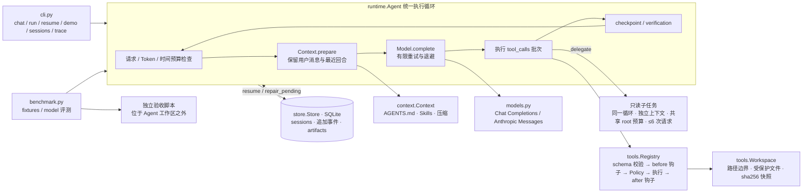

# CodeHarness

[](https://github.com/twi66li/CodeHarness/actions/workflows/ci.yml)

使用 Python 实现的可扩展编码 Agent 运行时。Python 3.11+，运行时仅使用标准库。

[English](README.en.md)

## 架构



| 模块 | 职责 |
| --- | --- |
| `runtime.py` | 执行循环、预算与超时、重试、工具批次、只读委派、最终状态与验证判定 |
| `models.py` | Chat Completions 与 Anthropic Messages 适配、SSE 流式、错误分类与重试 |
| `tools.py` | 工作区路径边界、权限策略、工具注册与参数校验、内置文件/搜索/测试/Git 工具 |
| `context.py` | 系统提示、`AGENTS.md` 与 Skills 加载、超阈值时的历史回合压缩 |
| `store.py` | SQLite 追加事件、产物分页、用量汇总、中断工具调用的补全 |
| `benchmark.py` / `benchmark_tasks.py` | 独立验收评测、委派消融、业务夹具 |

## 运行

```powershell
python -m codeharness demo
python -m unittest discover -s tests -v
```

`demo` 在新建目录里演示：只读委派 → 定位 → 失败测试 → 修改 → 验证。
它使用确定性适配器，不调用真实 AI，结果不代表模型修复成功率。

接入支持原生工具调用的 Chat Completions 兼容接口：将 `.env.example` 的配置填入本地 `.env`。

```powershell
python -m codeharness run "给项目增加一个功能并验证" --workspace D:/your/repo --env-file .env
```

默认逐次询问写入和测试执行权限。非交互环境需要显式传入 `--allow-write`、`--allow-exec`。
`--isolate` 从干净 Git 仓库的 HEAD 创建独立 worktree，修改结果保留供检查。
使用 `--no-delegate` 可以关闭探索子任务；使用 `--model-attempts` 调整单轮模型最大尝试次数（默认 3，含首次请求）。

### 交互模式

```powershell
python -m codeharness chat --workspace D:/your/repo --env-file .env --confirm
```

`chat` 默认流式输出，并允许模型直接写文件和执行终端命令。请在可信工作区使用。`--confirm` 开启逐次确认，`--no-bash` 关闭模型的终端工具，`--no-stream` 等待整轮响应。`--tool-profile pi` 只向模型提供读取、新建、编辑和终端工具。`!命令` 由用户直接执行，使用宿主权限。

`/compact` 压缩较早对话。`/tree` 查看回合，`/fork 2 备注` 从第 2 回合分叉，`/switch <ID>` 切换分支。分支共享当前工作目录，切换时请核对磁盘文件。

启用 `--discover-extensions` 可加载可信的 `.codeharness/extensions/*.py`，也可以用 `--plugin` 指定文件。交互会话默认启用本地记忆，支持 `/pin`、`/memory` 和 `/remember`，可用 `--no-memory` 关闭。

使用 Anthropic 原生协议时，设置 `ANTHROPIC_API_KEY`、`ANTHROPIC_MODEL`，并传入 `--provider anthropic`。自定义网关使用 `ANTHROPIC_BASE_URL`。交互中 `/model <模型名>` 沿用当前协议，`/model anthropic:<模型名>` 或 `/model openai:<模型名>` 可切换协议。新模型会收到已有会话上下文。

### 会话记录

```powershell
python -m codeharness sessions --workspace D:/your/repo
python -m codeharness resume SESSION_ID --workspace D:/your/repo --env-file .env
python -m codeharness trace SESSION_ID --workspace D:/your/repo --json
python -m codeharness trace SESSION_ID --workspace D:/your/repo --timeline
```

`--timeline` 按事件顺序显示模型请求（`turn`/`attempt`）、用量与耗时（`duration_ms`）、工具、压缩、委派、验证与结果，可与 `--json` 合用。以下为一次 `multi` 订单任务的 UTC 时间线节选，省略了小数秒和调用 ID。Agent 耗尽预算时还没运行工作区测试，外部独立验收已通过。

```text
15:23:33  model_request  model=deepseek-v4.1-flash max_tokens=4096
15:23:34  tool_started   name=list_files
15:23:50  tool_finished  name=edit_file ok=True
15:23:54  result         status=budget_exhausted verification=not_run
```

## 运行机制

- 主任务和只读探索子任务共用执行循环、请求与 Token 预算；子任务独立上下文，最多 6 次请求。
- 模型请求与重试共享预算；429、常见临时 5xx 和可重试连接错误有限重试，遵循 `Retry-After` 或指数退避。权限与认证拒绝终止当前任务，不自动绕过。
- 工具统一注册并声明权限。编辑校验 SHA-256，拒绝过期内容及工作区外路径；写入或编辑 `.py` 文件时附带非阻塞语法诊断。
- 支持按 glob（含 `**/`）搜索、单文件 `unittest` 和非执行式 `check_syntax`。Git 仓库根目录提供只读 `git_status` 和 `git_diff`，差异相对 HEAD，仅包含可见的已跟踪文件，输出过长时可缩小路径。
- SQLite 追加记录模型输入、工具结果、用量和状态；长输出保存在产物中，可按页读取。
- 恢复时补全中断的工具结果并核对文件变化，不自动重放结果未知的写操作。
- 上下文超出阈值后压缩较早的完整回合，保留所有用户消息及最近回合；这不是语义摘要。
- 项目根目录 `AGENTS.md` 提供规则；`.codeharness/skills/<name>/SKILL.md` 的正文按需加载。
  Skill 可用 `---` 包裹 `description: 简短说明`，目录名作为调用名称。
- `--plugin examples/line_count.py` 演示可信 Python 工具扩展；注册表也提供 `before` / `after` 回调。

`verified` 仅表示当前工作区最后一次测试通过且文件内容仍一致；失败或无法完成的后续测试会使旧验证失效。它不能替代独立功能验收。
Token 预算在请求前估算、返回后按 usage 校正；仅对可能已产生输出的失败尝试（如 5xx、超时、长度截断）按估计输入及输出上限保守预留并标记 estimated，429 限流或鉴权拒绝等明确未生成输出的失败不虚扣输出预算，但仍占用共享请求上限。不是供应商侧的硬计费限额。
每次模型尝试及测试执行使用任务剩余时间，且分别最多 60 秒；Git 查询最多 15 秒。超时在调用边界检查，不能保证立即终止所有宿主进程。
连续 5 次工具操作的参数和结果都相同时，会话以 `stalled` 结束，CLI 返回 2。会话记录保留此前的重复操作提示，可用 `trace` 查看。
默认测试与 `bash` 在本机进程执行（路径检查、权限和 Git worktree 不构成操作系统沙箱）；如需 OS 级隔离，可在 `run`、`resume` 或 `chat` 中传入 `--sandbox docker`（可选 `--sandbox-image python:3.12-slim`），将命令与测试放入断网（`--network none`）、只读根文件系统、限制内存/CPU/PID 且仅挂载工作区的临时容器执行，超时通过 `docker rm -f` 回收整棵进程树。
测试工具和独立验收使用环境变量白名单。`run`、`resume` 可用 `--pass-env NAME` 显式传递进程变量，敏感名称会触发提示。常见私钥和凭据文件名会被工作区工具过滤。
Git 工作区中的未跟踪忽略文件不参与列表、搜索或 `changed_files`。`search` 支持 `regex` 和 `max_results`，正则搜索在可用时使用 ripgrep。
需要多处或多文件修改时，可使用 `apply_patch`。统一 diff 支持成对的 `---`、`+++` 文件头，也支持现有文件用 `---` 后直接接 `@@`。补丁末尾可用 `*** End Patch` 或 `--- End Patch`。OpenAI 风格补丁以 `*** Begin Patch` 开头，支持 `*** Update File:`、`*** Add File:` 和 `*** Delete File:`。

片段正文按空格、`-`、`+` 前缀书写。有原文时可省略行号，声明的行数允许偏差。原文有多处匹配时，行号只能选出唯一最近的一处，等距或缺少行号会被拒绝。纯插入及统一 diff 新建文件需提供旧文件起始行号。工具先校验全部片段，再逐文件替换。`run`、`resume` 和 `benchmark` 可用 `--disable-tool apply_patch` 禁用它。
扩展是可信本地 Python 代码，拥有宿主权限；只读子任务不加载自定义扩展。

模型适配器实现 `complete(messages, tools, max_tokens, *, timeout=None) -> Reply`；`timeout` 为调用剩余时间上限。Chat Completions 适配器在对端返回字符串型 `reasoning_content` 时保留该字段供后续调用，具体供应商兼容性需真实联调。会话 trace 可能包含私有代码、需求或模型返回内容，勿公开整个数据库。

## 独立评测

运行 12 个基础多文件样例（`full`）或 3 个 11 文件多模块后端样例（`multi`），验证初始缺陷与参考修复：

```powershell
python -m codeharness.benchmark --mode fixtures --suite full
python -m codeharness.benchmark --mode fixtures --suite multi
python -m codeharness.benchmark --mode fixtures --suite large
```

首批 5 个（`core`）覆盖购物车折扣、分页、库存、配置合并及 Decimal 发票；`full` 在此基础上增加日期报表、CSV 导入、订单去重、退避计算、商品搜索、运费及指标统计；`multi` 提供 3 个 11 文件多模块后端样例（订单结算管线、多租户 RBAC 网关、财务幂等对账），均需跨 3 个模块联动修复。它们是可复现的业务夹具，不是从真实开源项目采集的 issue。

`large` 提供 4 个固定种子生成的大仓库任务，各有两份长业务模块及包含同名函数的历史实现。评测程序在全新工作区运行相同的独立验收脚本，脚本位于工作区之外。初始版本必须因需求断言失败，然后由参考实现或真实 Agent 独立验证。报告包含 `success`、请求次数、Token、耗时及预算跳过项，保存为 `.codeharness/benchmarks/<id>/report.json`。数据库与样例工作区留在报告目录供追溯。

### 真实模型与消融实验

在已配置 `.env`、明确接受本机执行测试代码且已确认调用预算的环境中：

首轮建议固定模型并仅试跑 `discount`，确认原生工具调用、独立验收及预算行为，再扩大到 5 个核心任务。当前联调首选 `glm-5.3`：

```powershell
python -m codeharness.benchmark --mode model --task discount --model glm-5.3 --env-file .env --allow-exec --total-requests 12 --total-tokens 24000
```

`.env` 使用获授权的模型配置，支持 `CODEHARNESS_BASE_URL`、`CODEHARNESS_API_KEY` 和可选 `CODEHARNESS_MODEL`。未设置命令行地址、CodeHarness 或 OpenAI 地址时，也可读取 `DASHSCOPE_BASE_URL` 和 `DASHSCOPE_API_KEY`，并用 `--model` 指定模型。凭据留在本地配置。`--task` 与 `--suite` 互斥。报告的 `diagnostics` 提供模型错误、重试、工具错误及失败验证次数，并按工具名汇总工具错误。

```powershell
python -m codeharness.benchmark --mode model --suite core --env-file .env --allow-exec --total-requests 60 --total-tokens 120000
```

对比委派启用与禁用，在每个任务上使用独立工作区、相同模型、相同单任务限额（默认 12 个请求、24000 Token、180 秒）：

```powershell
python -m codeharness.benchmark --mode model --suite core --variants both --env-file .env --allow-exec --total-requests 120 --total-tokens 240000
```

总预算不足以启动一组对比任务时记为 skipped。供应商实际计费用量可能超过运行时的估算预算。认证或访问被明确拒绝时停止后续任务。只对完整的成对结果比较成功率、Token 和耗时，并考虑模型输出非确定性。`--output-tokens` 调整单次输出上限，默认为 2048。`--output` 可指定尚不存在的报告目录，`--suite full` 扩展到 12 个基础任务，`--suite multi` 运行 3 个 11 文件多模块后端任务。报告 `diagnostics` 同时统计 `delegate_calls` 与 `compactions`。

模型接口支持时，可在 `run`、`resume` 或 `benchmark` 中用 `--reasoning-effort low` 调低推理强度。评测报告会记录显式设置的值。`glm-5.3` 的可选值见 [百炼 GLM 文档](https://help.aliyun.com/zh/model-studio/glm)。

`--repeats N` 为每个任务和变体重复运行 N 轮，总预算应覆盖这些轮次。`--context-chars` 指定触发上下文压缩的字符阈值。`cache_hit_ratio` 是供应商报告的缓存命中 Token 数除以输入 Token 数。输入用量为零时结果为 `null`。

```powershell
python -m codeharness.benchmark compare --baseline baseline/report.json --treatment treatment/report.json
```

比较按同一模型、任务和轮次配对，按模型给出成功率差、bootstrap 95% 置信区间，以及请求数和 Token 差值的中位数。报告含多个委派变体时，用 `--baseline-variant` 或 `--treatment-variant` 指定所选变体。

基准验收仍在本机执行模型编写的 Python 代码，独立验收目录不是防篡改安全沙箱。仅用于可信评测任务。

### 模型额度池

将 `models.example.json` 复制到 `.codeharness/models.json`。用供应商控制台更新 `quota_as_of`、`quota_tokens` 和到期日，然后执行 `python -m codeharness.model_pool status` 核对余额。多个工作树使用同一份配置和台账时，传入同一个绝对配置路径。

```powershell
python -m codeharness.benchmark --mode model --task discount --model-pool .codeharness/models.json --models deepseek-v4.1-flash,deepseek-v4.1-flash-1017 --env-file .env --allow-exec --total-requests 12 --total-tokens 24000
```

评测在同一模型内完成整组对照。额度耗尽时会记录已用量，并在另一可用模型上重新运行整组。`run` 和 `resume` 也接受 `--model-pool` 与 `--models`，会话预算按每次实际请求统计。`sessions` 显示会话开始时的模型，每次请求使用的模型可在 `trace` 的 `model_request` 中查看。

### 当前实测与边界

| 评测项 | 模型 / 范围 | 结果与关键指标 |
| --- | --- | --- |
| 单元测试与契约回归 | 离线全量 | 163/165 通过（2 跳过：符号链接权限与默认关闭的规模测试） |
| 参考夹具独立验收 | `full` 12 + `multi` 3 + `large` 4 | 19/19 全部通过（0 次模型调用） |
| `glm-5.3`（`low`, 4096） | `core` / `multi` | `core` 4/5（`invoice` 澄清后 1/1）；`multi` 3/3（22 请求、62,579 Token、0 错误） |
| S13 同模型对照（百炼） | `deepseek-v4.1-flash` / `flash-1017` | `core` 10/10 → 10/10；`multi` 6/6 → 3/6；开放委派未触发自发调用 |
| Magpie 同渠道续测与补丁收尾 | `workbuddy/deepseek-v4.1-flash` | 坏补丁离线回放 6/27 → **27/27**，80 次 Python 语法检查通过；`core` 5/5；`multi` 启用/禁用补丁均 **6/6**（请求中位数 10）；显式单文件委派通过验证（2 请求），原题未自发委派 |

- **结论边界**：所有比较均在同一渠道与同一模型内配对；`n = 2` 样本量有限，委派在无显式引导的大仓库原题上仍待进一步验证收益。本地完整报告保存在 `.codeharness/benchmarks/`。

正常环境使用 `python -m unittest discover -s tests -v` 完整回归。如果明确禁止本地回环连接，可以在 PowerShell 设置 `$env:CODEHARNESS_SKIP_LOOPBACK='1'`，显式跳过 5 项真实本地 HTTP 集成测试；模拟传输与 CLI 工具链测试仍然运行。该模式不等同于完整网络回归。

`python -B scripts/regress.py --tag <标签>` 运行单元测试、`full`、`multi`、`large` 参考夹具及启用、禁用委派的离线 demo。结果与日志写入 `.codeharness/regress/`。`--compare <summary.json>` 与之前的结果对比，`--skip-loopback` 等同于上面的环境变量。CI 在 Ubuntu 与 Windows、Python 3.11～3.13 上运行同一脚本。

## 设计取舍

- 执行循环不绑定特定供应商 SDK，明确隔离模型接口、工具权限、上下文、事件持久化和 CLI。
- SQLite 事件保留可复现的输入与执行证据；文件检查点用于判断变化，不是自动事务回滚。
- 优先只读探索、必要时编辑并测试，以独立验收评价任务结果；语法诊断不是功能验证，也不阻断多步中间编辑。
- 轻量且可观测优先于高并发、多模型编排或图形界面；真实模型数据应当驱动下一阶段优化。

设计参考：[Pi](https://github.com/earendil-works/pi)、
[Claude Code 公开文档](https://code.claude.com/docs/en/how-claude-code-works)、
[DeepSeek Harness](https://github.com/deepseek-ai/deepseek-harness)、
[oh-my-pi](https://github.com/can1357/oh-my-pi)。本项目用 Python 独立实现，未复制其运行时代码。
